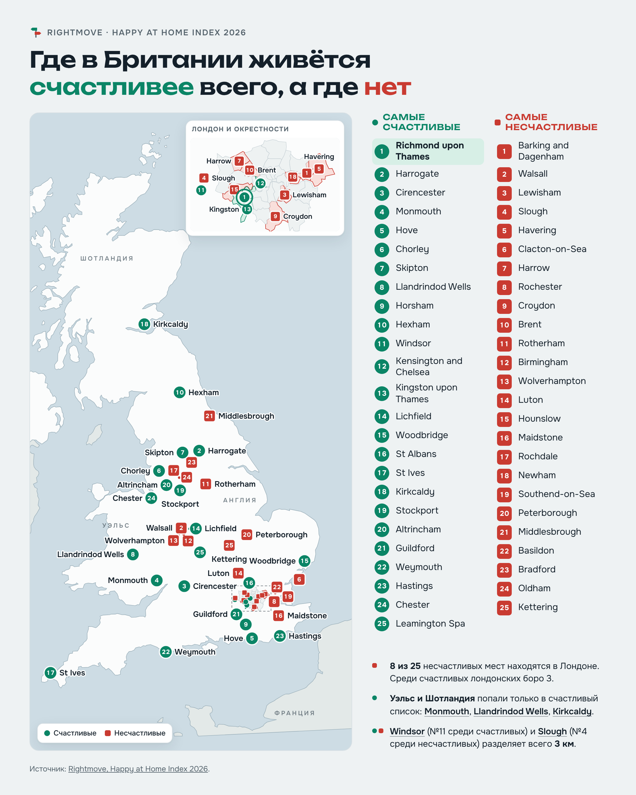

# Карта счастья Британии 2026

Интерактивная карта 25 самых счастливых и 25 самых несчастливых мест Великобритании
по индексу [Rightmove Happy at Home 2026](https://www.rightmove.co.uk/press-centre/?p=5461).

- **Приложение:** https://claude.ai/artifact/GAf8njkbnUgNCdixodYWuF
- **Картинка для Telegram:** [`telegram.png`](telegram.png) (1080×1350, @2x)



## Что умеет

- зум и перетаскивание карты, кнопки «Вся страна» и «Лондон»;
- врезка «Лондон и окрестности» с границами боро;
- фильтр «Все / Счастливые / Несчастливые»;
- карточка места: место в рейтинге, графство, ближайшее место из противоположного списка, ссылка на Google Карты;
- ссылки на конкретное место через `#`, например `#slough` или `#richmond-upon-thames`;
- светлая и тёмная тема, мобильная вёрстка.

## Файлы

| Путь | Что это |
| --- | --- |
| `src/template.html` | исходник приложения (разметка, стили, логика на D3) |
| `data/land.geojson` | береговая линия Британии и соседей, Natural Earth 1:10m (упрощено) |
| `data/london-boroughs.geojson` | границы 33 лондонских боро, ONS/OS (упрощено) |
| `tools/build.mjs` | собирает `index.html` и `dist/artifact.html` |
| `tools/screenshot.cjs` | рендерит `telegram.png` через Playwright |
| `index.html` | готовая самостоятельная страница |

## Сборка

```bash
node tools/build.mjs          # index.html + dist/artifact.html
node tools/screenshot.cjs     # telegram.png
```

## Публикация на GitHub Pages

`index.html` работает без сервера. Чтобы получить публичную ссылку вида
`https://mdklab.github.io/UK-happiest-places-2026/`, включите Pages в
**Settings → Pages → Deploy from a branch** и выберите ветку с этими файлами.

## Источники

- Рейтинг: Rightmove, Happy at Home Index 2026 (инфографика Mirror).
- Точки стоят в центрах городов; для лондонских боро — в центре района.
- St Ives — город в Корнуолле.
- Границы: Natural Earth (public domain); Contains National Statistics and OS data © Crown copyright and database right.
